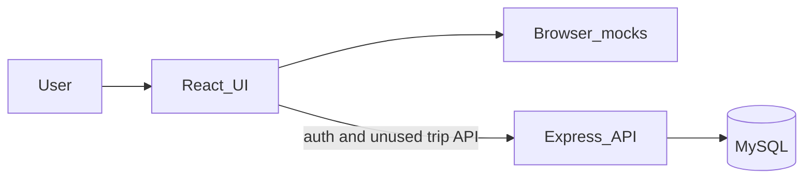

# AI Travel Planner — architecture analysis

## 1. Summary and assumptions

The product compares a whole trip (transport + stay + cost + later AI ranking), sends the user to partners to book, and will later add Free/Premium. It is a learning project with a commercial path, not a high-scale system yet.

**Assumptions:** one developer, low traffic, no real flight/hotel/AI APIs yet, no payments yet, five UI languages (en, fi, ru, de, fr).

**What is actually built**

- Frontend search and planner run on **in-browser mocks**.
- Auth (register, login, logout, profile, password) is real: HTTP-only cookie sessions, bcrypt, Zod.
- Prisma models exist for User, Session, Trip, options, transport, stays, itinerary, costs.
- The screen “My Trip” is **not** those database trips. It is `localStorage` key `atp.currentTrip` in `frontend/src/services/trips/tripStorage.ts`.
- `PROJECT_CONTEXT.md` is stale (still says hotels/auth are types-only and paths live under root `src/`).

**Verdict:** keep the stack. Do not move to NestJS, microservices, or a second database. Fix the split between browser trip and server trip before adding AI or payments.

## 2. Requirements

**Functional (target, not all built)**

- Search flights, stays, later tours and local transport.
- Assemble one current trip and compare total cost vs inconvenience (cheapest is not best).
- AI planner: options, then a day plan. Today this is mocks behind `frontend/src/services/planner/tripPlanningService.ts`.
- Accounts, saved trips, later Premium (plans, alerts, shared trips). Affiliate click-out, never own checkout.

**Non-functional**

- UI stays usable if the API is down (search mocks already do this; auth shows “unavailable”).
- Passwords hashed; session identity from the cookie, never a client `userId`.
- Secrets only on the server. i18n keys stay in sync across five locales.

**Constraints**

- Do not redesign Transport, Hotels, or Planner UI.
- Do not add payments, real travel APIs, or a new main nav section until those are explicit tasks.

## 3. Architecture style

**Modular monolith.** One React app, one Express process, one MySQL database. Domains are folders (`features/`, `routes/` + `services/`), not separate deployables.

Why: one person, shared trip model, no independent scaling need. Microservices would duplicate auth, types, and deploys. NestJS would rewrite the same HTTP layer without improving AI or search.

See [ADR-1](adr/0001-modular-monolith.md).

## 4. Components

- **Web UI** — React 19, Vite, React Router, CSS modules, i18n. Owns screens and client state. Does not own passwords, API keys, or “which user is this”.
- **Browser services** — mocks for flights, hotels, locations, planner. Contract is `TripPlanningService` and search providers. Data is demo data, not MySQL.
- **Current trip (client)** — `TripProvider` + localStorage. Owns the drawer the user sees. Does not call `GET /api/trips/me`.
- **API** — Express in `backend/src/app.ts`: `/api/health`, `/api/auth`, `/api/users`, `/api/trips` (auth required), `/api/accommodations`, `/api/transport`. Validates with Zod. Identity from session cookie `atp_sid`. See [ADR-2](adr/0002-cookie-sessions.md).
- **Database** — Prisma + MySQL in `database/prisma/schema.prisma`. Owns users, sessions, persisted trips. Catalog list endpoints read the same tables; the UI does not use them yet.

See [ADR-3](adr/0003-ai-behind-trip-planning-service.md).

## 5. Data model and flows

**Entities:** User 1—N Session; User 1—N Trip; Trip 1—N TripOption, Transport, Accommodation, TripCost; Trip 1—1 Itinerary — N days — N activities.

Money is integer minor units. `subscriptionPlan` is `FREE | PREMIUM` on User only. No Payment or Subscription table (correct for now).

**Two trip shapes (the main problem)**

- Client `Trip`: rich offer objects, warnings, estimated total, localStorage.
- Server `Trip`: relational rows, `userId` optional, JSON blobs for travelers and summaries.

**Flows today**

- Search/planner: browser → mock → React state → localStorage. API not involved.
- Register/login: browser → Express → bcrypt/session → MySQL → cookie → `/api/auth/me`.
- Saved trips API: cookie → `requireAuth` → trips where `userId` is the session user. UI never calls this.

## 6. What is already good

- Folder split `frontend/` `backend/` `database/` matches the runtime.
- Auth does not trust a body `userId`; trip routes use the session and return 404 for another user’s trip.
- Planner has a replaceable service interface.
- i18n is typed from English; design tokens are centralized.
- Express layering (route → controller → service → Prisma) is enough. Do not add a framework for structure.

## 7. What to do better (priority)

1. **One current trip.** When the user is logged in, the drawer should read and write that user’s server trip (or a single “current” trip row). Keep localStorage only as a guest draft, then attach it on login. Until this exists, accounts and “saved trips” are separate products.
2. **Stop duplicating the domain.** Frontend `Trip` / `JourneyOffer` and backend `TripRecord` / Prisma models will drift. Add one shared contract (OpenAPI or a small `shared/` package) for trip, money, and place. Do not generate the whole UI from Prisma.
3. **Call AI only from Express** when you add it. Implement `TripPlanningService` on the server, validate JSON with Zod, persist `TripOption` + `Itinerary`. Prefer OpenAI structured JSON first; DeepSeek only as a cheap draft model with the same Zod gate.
4. **Do not invent prices in the model** once partner APIs exist. The model ranks real offers. Scoring (`convenienceScore`) stays deterministic code, not a prompt.
5. **Align plan types.** Backend `SubscriptionPlan` is `FREE | PREMIUM`. Frontend `frontend/src/features/subscription/access.ts` uses `free | premium` and is not wired to `user.subscriptionPlan`. One enum, display-only until payments.
6. **Harden auth before public use:** rate-limit register/login, generic errors (already), email verification and password reset later, session cleanup. No CSRF token required for cookie + `SameSite=Lax` JSON API if you do not add cookie-auth form posts from other sites.
7. **Tests that hit the real cookie:** register, 401 without cookie, user A cannot read user B’s trip. No tests exist now.
8. **Observability:** request id + structured error logs. Health already reports `db: up|down`.
9. **Refresh `PROJECT_CONTEXT.md`** so the next session does not rebuild auth or hotels.
10. **Leave alone for now:** NestJS, microservices, Stripe, a separate Subscription table, SSR/i18n URLs, tour-operator ingestion.

## 8. Risks

- Guest trip and account trip diverge, so logout/login “loses” the plan the user just built.
- AI in the frontend would leak keys and skip validation.
- Optional `Trip.userId` allows rows no user can see via `/api/trips/me`.
- Local MySQL is easy to point at the wrong server (another project’s container on port 3306). Document `DATABASE_URL` and do not commit real `.env`.

## 9. Roadmap

- **Now:** keep mocks for search; persist the current trip for the logged-in user; add auth/ownership tests.
- **v1:** backend planner endpoint implementing the existing interface; Zod-validated JSON; still no live GDS.
- **Later:** partner search providers, scoring, affiliate clicks, then Premium limits using the existing plan enum. Split services only if search or AI jobs block the API.

## 10. Project structure

- `frontend/` — UI, mocks, client trip, auth UI
- `backend/` — HTTP, auth, persistence, future AI and partner calls
- `database/` — Prisma schema and migrations only
- `docs/` — this analysis and ADRs in `docs/adr/`

No new top-level app. No second backend.
